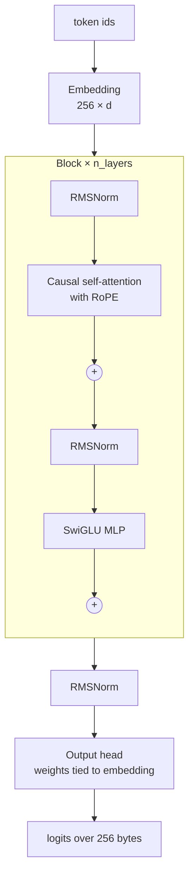

# Architecture

Asura is a **decoder-only transformer**, the same family as GPT and Llama, built from the
modern Llama-style building blocks. All of it lives in `asura/model.py` (~150 lines).



## Configuration

```python
@dataclass
class AsuraConfig:
    vocab_size: int = 256        # byte-level tokenizer
    context_len: int = 256       # max sequence length
    d_model: int = 256           # residual stream width
    n_layers: int = 6
    n_heads: int = 8
    mlp_mult: float = 8 / 3      # SwiGLU hidden size = mlp_mult × d_model (rounded to 64)
    dropout: float = 0.0
    rope_base: float = 10000.0
```

## Components

### Residual stream
Every block *adds* its output to a running vector $x$ ("pre-norm residual"):

$$x \leftarrow x + \text{Attn}(\text{RMSNorm}(x)), \qquad x \leftarrow x + \text{MLP}(\text{RMSNorm}(x))$$

Information flows straight through the network, and each layer reads from and writes to this
shared stream. This is the view interpretability research takes (see U3's linear probes).

### RMSNorm
$$\text{RMSNorm}(x) = g \odot \frac{x}{\sqrt{\tfrac{1}{d}\sum_i x_i^2 + \epsilon}}$$
Cheaper than LayerNorm (no mean subtraction, no bias) and works as well in practice.

### Causal self-attention
Each position builds a query $q$, key $k$ and value $v$, then mixes the values of **earlier**
positions weighted by similarity:

$$\text{Attn}(Q,K,V) = \text{softmax}\!\left(\frac{QK^\top}{\sqrt{d_h}} + M\right)V$$

$M$ is the causal mask ($-\infty$ above the diagonal), so a token can't see the future.
Asura uses PyTorch's fused `scaled_dot_product_attention(is_causal=True)`. `n_heads` heads
each work in $d_h = d/\text{n\_heads}$ dimensions.

### Rotary position embeddings (RoPE)
Instead of adding a position vector, RoPE **rotates** each pair of query/key dimensions by an
angle proportional to the position. The dot product $q_m \cdot k_n$ then depends only on the
*relative* offset $m-n$, which tends to generalize better than learned absolute positions.

### SwiGLU MLP
$$\text{MLP}(x) = W_\text{down}\big(\text{SiLU}(W_\text{gate}x) \odot W_\text{up}x\big)$$
A gated MLP. The "gate" branch decides how much of the "up" branch passes through.

### Tied embeddings
The output head reuses the embedding matrix (`head.weight = embed.weight`). That saves
parameters, and at small scale it usually helps.

### Initialization
Weights start at $\mathcal{N}(0, 0.02)$. The two projections that write into the residual stream
(`attn.proj`, `mlp.down`) are scaled down by $1/\sqrt{2\,n_\text{layers}}$ (GPT-2 style) so the
stream doesn't grow with depth.

## Counting parameters

With hidden size $h = 64\lceil \tfrac{8}{3}d / 64 \rceil$:

| Part | Parameters |
|---|---|
| Embedding (shared with head) | $256\,d$ |
| Attention per layer | $4d^2$ (q, k, v, out) |
| MLP per layer | $3dh$ |
| Norms per layer | $2d$ |
| Final norm | $d$ |

For the default laptop model ($d=96$, 3 layers, $h=256$):
$256·96 + 3(4·96^2 + 3·96·256 + 2·96) + 96 = \mathbf{357{,}024}$, which matches `model.num_params()`.

!!! example "Exercise"
    Predict the parameter count for `d_model=384, n_layers=6`, then check it with
    `python -c "from asura import *; print(Asura(AsuraConfig(d_model=384,n_layers=6,n_heads=6)).num_params())"`.

## Generation

`Asura.generate(idx, max_new_tokens, temperature, top_k, stop_token)` feeds the last
`context_len` tokens, picks the next token (greedy if `temperature=0`, otherwise sampling,
optionally top-k), appends it, and repeats until `stop_token` (newline in all experiments).
