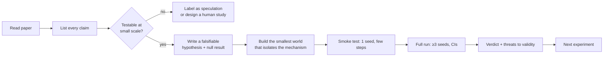

# Testing a paper claim

This is the workflow used for every paper in [Research](../research/index.md).

## 1. Fill in the worksheet
Copy `papers/TEMPLATE.md` to `papers/<short-name>/PLAN.md`. The key fields:

- **Hypothesis:** *If we change ___, then ___ will ___ (direction, rough size).*
- **What a null result looks like.** Write it **before** running.
- **Everything held fixed:** data, steps, parameter count (±10%), LR schedule, seeds.

## 2. Pick the cheapest faithful setup

| The claim is about… | Build… | Example |
|---|---|---|
| What a model learns from data | A synthetic task + data knob in `asura/data.py` | Clean Data: messy rendering, label noise |
| An architecture or training change | A config flag in `asura/model.py`/`train.py`, **default off** | Depth vs. width sweep |
| Behaviour under an optimization pressure | A custom loop with a simulated reward | U1: trust-optimization |
| What's happening inside the model | Probes / ablations / counterfactual inputs | U3: faithfulness |
| A system or market, not a model | A small simulation, no LM needed | Imported Algo: lending sim |

!!! warning "The simulation trap"
    In a simulation **you write the data generator**, so the generator encodes your assumptions.
    A simulation can show an argument is *internally coherent*, and which assumptions it
    depends on. It cannot show the real world works that way. Always state this next to the results.

## 3. Smoke test, then full run
Start with 1 seed and ~10% of the steps to catch bugs. U3's smoke test, for example, showed the
probe was reading the wrong token position before the full run was launched.

## 4. Write the verdict honestly
For each claim: **Supported / Not supported / Inconclusive**, the numbers with CIs, and what would
change your mind. The Imported Algo write-up is the model: 3 claims supported, 2 not, and the
"not supported" findings are the most useful parts.
