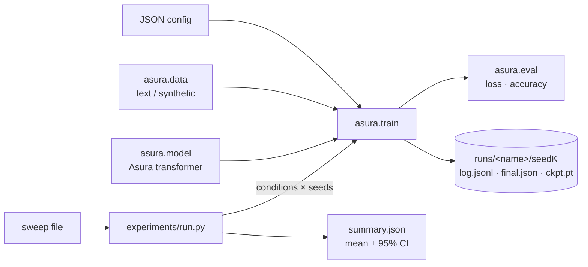

# Asura

**Asura** is a small language model built from scratch in PyTorch. It doubles as a test bench
for putting research claims through controlled experiments: one variable changed, several seeds,
confidence intervals, honest verdicts.

It was built to test four position papers on AI safety and AI in emerging economies
(see [Research](research/index.md)), and to be a readable codebase for learning how language
models are built, trained and evaluated.

- :material-rocket-launch: **[Get started](getting-started/install.md)**: install and train your first model in ~10 minutes on a laptop CPU
- :material-brain: **[How it works](concepts/architecture.md)**: every component of the transformer, explained
- :material-flask: **[Testing a paper claim](guides/new-experiment.md)**: turn a claim into a falsifiable experiment
- :material-chart-line: **[Results](research/index.md)**: what held up, what didn't

## At a glance

| | |
|---|---|
| Architecture | Decoder-only transformer: RMSNorm, rotary position embeddings (RoPE), causal self-attention, SwiGLU MLP, tied embeddings |
| Tokenizer | Byte-level (vocab 256), so any language/script works, including Assamese |
| Default size | 0.36M parameters (laptop CPU); scales to ~10M+ on a free GPU |
| Data | Any `.txt` corpus, or synthetic tasks with known ground truth and controllable "messiness" |
| Evals | Held-out loss/perplexity, exact-match accuracy on *unseen* prompts, per-subgroup metrics |
| Experiments | Grid or named conditions × seeds → mean, std, 95% CI; resumable |
| Runs on | CPU, NVIDIA GPU (Colab/Kaggle/cloud), Apple GPU |

## How the pieces fit

## Research status

| Paper | Experiment | Status |
|---|---|---|
| The Imported Algo and the Chowk (Chor) Bazaar | Two-region lending simulation | ✅ Done: 3 claims supported, 2 not |
| Why AI Trained on Clean Data Struggles | Messy inputs, random vs. systematic label noise | 🔄 Running |
| The Uncanny Valley of Intelligence | U3: self-explanation faithfulness | 🔄 Running |
| The Hardest Tradeoff in AI Safety | U1: trust-optimization Goodhart curve | ⏳ Queued |
